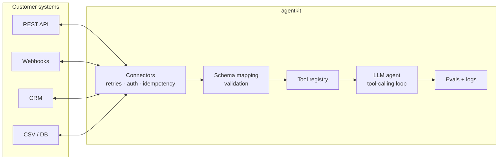

# Customer Integration Agent Kit

[](https://github.com/hrutishaa/customer-integration-agent-kit/actions/workflows/ci.yml)


A Python toolkit for the work a **Forward Deployed Engineer** does on day one at a new customer: connect to their messy systems (REST APIs, webhooks, CRMs, CSV exports, databases), map their schema to yours, and let an LLM agent act on that data safely.

## Why

Most of an LLM integration project isn't the model. It's the plumbing: flaky APIs that return 429s, tokens that must stay out of code, CSV exports with odd columns, and writes that must never run twice. This kit makes that plumbing reusable and tested, so the agent layer stays small.

## Architecture



## What works today (v0.1)

| Piece | Highlights |
|---|---|
| `Connector` | One `read` / `write` / `health_check` interface for every system |
| `RestConnector` | httpx, timeouts, auth token from an env var, exponential backoff + jitter on 429/5xx and network errors, honors `Retry-After`, only retries POST when an `Idempotency-Key` is given |
| `CSVConnector` | Filtered reads, append-safe writes that reject unknown columns, path-traversal guard |

## Quickstart

```bash
git clone https://github.com/hrutishaa/customer-integration-agent-kit
cd customer-integration-agent-kit
python -m venv .venv && source .venv/bin/activate
pip install -e ".[dev]"
pytest -q
```

```python
from agentkit import RestConnector, CSVConnector

# token is read from the CRM_API_TOKEN env var, never hard-coded
with RestConnector("https://api.example-crm.com", token_env="CRM_API_TOKEN", data_key="data") as crm:
    open_tickets = list(crm.read("/tickets", status="open"))

CSVConnector("./exports").write("open_tickets", open_tickets)
```

## Roadmap

Webhooks, SQL and CRM connectors, YAML schema mapping, a tool-calling agent, an idempotency store, evals, a sample customer demo, and Docker. See [ROADMAP.md](ROADMAP.md).

## License

MIT © 2026 Hrutishaa Nanduti
